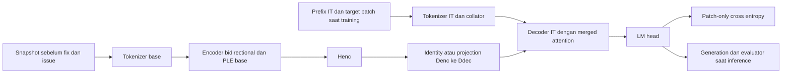

# BifocalGemma: Arsitektur Aktif dan Kontrak Implementasi

> **Status dokumen (2026-11-03):** halaman ini menjelaskan **V2 legacy**.
> Jalur produksi sekarang **V3** (`SwiGLUDualGateBridge` + decoupled full-rank
> cross-attention) di [`src/bifocalgemma/v3/`](../src/bifocalgemma/v3/).
> Lihat [peta repo](REPO_LAYOUT.md) dan
> [proposal riset V3](BIFOCALGEMMA_V3_RESEARCH_PROPOSAL.md).

Jalur training V2 adalah [normalized merged attention v2](BIFOCALGEMMA_V2.md).
Kontrak di bawah mendokumentasikan implementasi v1 yang tetap dapat dibaca:
v2 memakai linear+RMSNorm untuk semua pasangan dan embedding encoder terpisah.

## Keputusan aktif

| Aspek | Keputusan |
| --- | --- |
| Encoder | Text backbone Gemma 4 base, attention bidirectional |
| Decoder | Text backbone Gemma 4 IT, merged self/cross-attention sejak initialization |
| Training default | Direct SFT pada issue/context → patch; tidak membutuhkan teacher |
| Symmetric word embeddings | Encoder input = decoder input = decoder LM head, anchor decoder IT |
| Asymmetric word embeddings | Encoder/decoder terpisah; decoder input/LM head tetap tied internal |
| PLE | Tetap terpisah dan mengikuti jumlah layer masing-masing backbone |
| Context adapter | Identity untuk simetris; satu learned linear Denc → Ddec untuk asimetris |
| Default feature scope | Text-only; AST opsional sampai extraction dan ablation siap |
| Cache | Target inference saja; cache training/partial invalidation tidak aktif |
| Pembanding | Empat pasangan plus E2B-IT/E4B-IT decoder-only |

Arsitektur dibangun langsung dalam bentuk akhir. Encoder dan decoder tetap dua
komponen yang bisa dilacak sumbernya; yang digabung adalah attention dalam decoder.
Training terpisah → konversi → distillation tidak menjadi prasyarat studi utama.

## Aliran data dan tensor



Input encoder `[B,Lenc]`, mask `[B,Lenc]`, output `Henc=[B,Lenc,Denc]`.
Input decoder dan labels `[B,Ldec]`; labels prefix/padding bernilai -100.
Logits `[B,Ldec,V]`, dengan V=262144 pada config native. Reference memakai V=128.
Encoder tidak menerima gold patch, test_patch atau metadata evaluator. Baseline
decoder-only memiliki encoder IDs/mask [B,0] dan context yang sama di decoder prefix;
factory menggunakan native causal decoder tanpa H alignment/merged branch.

Collator men-shift sekali: input decoder berasal dari `(prefix+target)[:-1]`,
labels dari `(prefix+target)[1:]`, lalu masking prefix. Loss tidak men-shift lagi.
Position IDs valid mulai nol walaupun batch dipad kiri. Saat inference, hanya
prefix disuplai; target tidak tersedia.

## Initialization dan provenance

[Registry](../src/bifocalgemma/config.py) mem-pin encoder base dan decoder IT per
ukuran. [Initialization plan](../src/bifocalgemma/models/v2/initialization.py) dapat
diinspeksi tanpa memuat bobot.

- Encoder layers, norm dan PLE berasal dari checkpoint base.
- Decoder layers, norm, PLE, word table dan output projection berasal dari IT.
- Simetris: word table encoder diganti alias decoder IT sebelum optimizer dibuat.
  Jadi body/PLE encoder base, sedangkan shared ordinary words bersumber dari IT.
- Asimetris: ordinary word tables tetap dari sumber masing-masing. Adapter A baru
  diinisialisasi dan dilatih; tidak ada projected shared vocabulary table.
- Merged attention memakai proyeksi native decoder IT sebagai titik awal. Perubahan
  fungsi akibat encoder keys dan joint softmax dipelajari melalui direct SFT.
- Alias, source revision, tensor mapping, tokenizer hashes dan parameter baru
  harus disimpan pada run/checkpoint manifest.

M04 belum mentransfer bobot sebenarnya. Placeholder tidak memanggil from_pretrained,
tidak melakukan download dan tidak berpura-pura bahwa checkpoint telah terpasang.

## Merged attention yang ditargetkan

Untuk satu decoder layer, X adalah input setelah native input normalization,
H adalah final encoder state, dan A menyelaraskan hidden dimension:

```text
H' = A(H)
Q = Wq(X)
Ks, Vs = Wk(X), Wv(X)
Ke, Ve = Wk(H'), Wv(H')   # proyeksi K/V sama dengan decoder branch
attention = softmax(concat(self_logits, cross_logits) + joint_mask)
output = Wo(attention @ concat(Vs, Ve))
```

Ada satu normalisasi logits bersama. Ini berbeda fungsi dari penjumlahan dua
softmax terpisah dan gate pada GatedCrossAttentionBridge. Bridge lama tetap
tersedia sebagai reference/ablation; tidak dipakai default assembly.

Decoder self keys mengikuti causal visibility, local window pada local layers,
dan global visibility pada global layers. Encoder keys terlihat global pada
setiap merged decoder layer, dengan encoder padding tetap dimask. Merger tidak
dibatasi hanya pada tujuh global layers.

Native target mempertahankan 8 query heads, KV heads 1/2, local head_dim 256,
global head_dim 512, Q/K normalization, value normalization dan scaling Gemma 4.
T5Gemma 2 memberi pola decoder Q/self-K dengan RoPE serta normalized encoder-K
tanpa decoder RoPE. Port ke Gemma 4 harus memeriksa partial global RoPE, padding,
position IDs dan residual/norm placement; reference M01 belum menerapkan RoPE.

Sumber: [T5Gemma 2](https://arxiv.org/html/2512.14856v2#S2),
[implementasi T5Gemma 2](https://github.com/huggingface/transformers/blob/v5.18.0/src/transformers/models/t5gemma2/modeling_t5gemma2.py),
[Gemma 4](https://huggingface.co/docs/transformers/model_doc/gemma4).

## PLE, KV sharing dan cache

PLE mengikuti native packed tables: E2B [262144,8960], E4B [262144,10752].
M02 hanya menyatukan ordinary word table; tidak mengubah PLE, depth atau MLP.
E2B memakai 35 layers dan double-width MLP pada 20 KV-shared layers terakhir;
E4B memakai 42 layers dan 18 KV-shared layers.

Target M05 mempertahankan ownership shared K/V menurut jenis local/global layer.
Shared layers memakai self dan encoder K/V dari sumber unshared terakhir dengan
jenis layer yang sama; jangan menambahkan K/V projection baru diam-diam pada
setiap shared layer. Mekanisme ini harus diverifikasi pada tiny native integration
sebelum memakai bobot atau panjang konteks sebenarnya.

M06 memisahkan dynamic self-KV dan static encoder-KV. Cache key memuat context
tokens/issue/repo revision, tokenizer/AST policy dan revision checkpoint hasil
adaptasi. Perubahan file/issue/weights memicu full re-encoding. Cache lintas
optimizer step dan one-hop invalidation tidak tersedia.

## Word tying dan biaya

M02 meng-alias object Parameter, bukan menyalin nilainya sekali. Optimizer harus
melihat parameter unik; alias harus pulih setelah checkpoint load dan perpindahan
device. Simetris membutuhkan vocabulary, width, dtype dan device cocok. Asimetris
tidak men-sharing encoder words, tetapi tetap men-sharing decoder input/LM head.

Dari hitungan native sebelum perubahan attention, bobot text BF16 simetris turun
dari sekitar 18,514 ke 17,709 GB untuk E2B–E2B, serta 29,852 ke 28,510 GB untuk
E4B–E4B. Asimetris memiliki sekitar 24,183 GB sebelum adapter/attention changes.
Angka ini bukan peak VRAM training. [Audit JSON](GEMMA4_JSON_AUDIT.md) menyimpan
dasar hitungan; initializer/factory perlu menghitung model akhir secara aktual.

## Apa yang bisa dijalankan sekarang

[M01](../src/bifocalgemma/models/v2/merged_attention.py) memeriksa joint softmax,
GQA, asymmetric projection, causal/window/padding masks dan finite gradients.
[M02](../src/bifocalgemma/models/v2/embeddings.py) memeriksa parameter sharing.
[M03](../src/bifocalgemma/models/v2/reference.py) merakit embedding, satu generic
bidirectional TransformerEncoder dan satu reference merged-attention decoder.

M03 **bukan Gemma kecil lengkap**: tidak ada native RoPE, PLE, 35/42 decoder stack,
native KV sharing, checkpoint mapping atau autoregressive cache. Tes Gemma lama
tetap memeriksa config/native text model pada meta serta thin random-weight models;
tes tersebut tidak memverifikasi full merged Gemma integration.

M07 sekarang mengintegrasikan native Gemma encoder/merged decoder random-weight.
Saat context kosong/dimask, output cocok dengan native decoder pada token valid;
mask, PLE, RoPE dan KV ownership diperiksa termasuk panjang 513. Factory
pretrained M04/M05 dan cache M06 tetap belum siap. Detail dimensi/API dan batas
ada pada [native local validation](NATIVE_LOCAL_VALIDATION.md).

## Recipe tuning tanpa RL/VM — 6 Oktober 2026

Jalur aktif mengikuti [data recipe](DATASETS_AND_BENCHMARKS.md): offline patch-only
SFT memakai EditPackFT, dengan CommitPackFT Python opsional. Input instruksi/kode
sebelum edit dan target diff tersedia sebagai file, tanpa execution feedback,
agent rollout, VM atau Docker. Pilot single-file menguji adaptasi/instruction editing;
repository-level/multi-file claims memerlukan static multi-file held-out records.
SWE-smith/Gym, trajectory training dan SWE-bench environments ditunda dari jalur utama.
