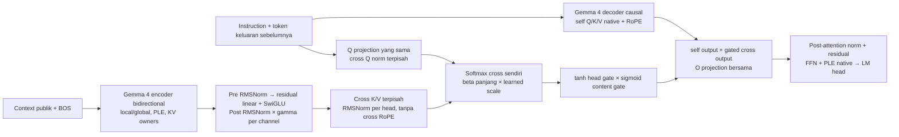

**Audit ASTRA BifocalGemma — 16 November 2026**

Pemeriksaan akhir laporan dan tautan sumber diselesaikan 17 November 2026 (Asia/Jakarta). Tanggal audit, commit yang diaudit, dan hasil probe tetap seperti di bawah.

Audit terhadap `80522ad65c7c68452727a65b19ccc26a702977e2`, dibandingkan dengan `071b331fe302c62b708f7448dfc6f318df52296d`. Pemeriksaan mencakup jalur matrix yang benar-benar dipakai, API HF, sumber primer, dan probe CPU kecil. Baseline lama yang sedang berjalan di Molab tidak disentuh. Tidak ada training baru, perubahan source produksi, instalasi paket, perubahan environment, atau upload HF dalam audit ini.

**Putusan utama: beberapa perbaikan kontrak memang benar, tetapi manfaat arsitektur terbaru belum terbukti.** Pembalikan arah beta, residual bridge yang sekarang dapat belajar, inisialisasi SwiGLU yang lebih besar, loss berbobot marker, dan clipping per grup adalah perubahan perilaku yang nyata. Kelulusan tes implementasi tidak membuktikan kelimanya meningkatkan kualitas. Ada satu kekurangan konkret yang masih aktif pada data: perbaikan whitespace belum menjangkau jalur raw repair. Ada pula flag ablation `learnable_cross_scale=False` yang diabaikan. Keduanya merupakan masalah lama yang masih tersisa, bukan regresi baru yang dibuktikan berasal dari commit terbaru.

Saya tidak menemukan bukti bahwa decoder menerima future target melalui attention, bahwa zero-init content gate mematikan seluruh bridge, atau bahwa gamma per-channel seluruhnya tidak berguna. Ketiga tuduhan tersebut tidak didukung pemeriksaan ini. Sebaliknya, ada alasan kuat untuk menguji grounding, objektif, dan lama pembekuan decoder sebelum menambah kerumitan arsitektur.

**1. Graph yang benar-benar dieksekusi**

Jalur matrix adalah `download_model → configure_policy_model → configure_memory_efficient_training → configure_full_rank_cross_attention`. Backbone native dimuat dahulu; K/V cross kemudian disalin dari bobot self-attention yang sudah dimuat. Jadi constructor `NativeTinyModel` yang sementara masih memakai merged attention bukan bukti bahwa training akhir memakai merged attention. Urutan konversinya terdapat di [matrix.py:978](https://github.com/daruoktab/bifocalgemma/blob/80522ad65c7c68452727a65b19ccc26a702977e2/src/bifocalgemma/training/matrix.py#L978), loader di [hub.py:437](https://github.com/daruoktab/bifocalgemma/blob/80522ad65c7c68452727a65b19ccc26a702977e2/src/bifocalgemma/training/hub.py#L437), dan konfigurasi cross di [cross_attention.py:475](https://github.com/daruoktab/bifocalgemma/blob/80522ad65c7c68452727a65b19ccc26a702977e2/src/bifocalgemma/models/cross_attention.py#L475).



Notasi berikut memakai row vector dan satu head untuk memudahkan pembacaan. Dengan `RN` sebagai RMSNorm, bridge saat ini adalah:

\[
U=RN_{pre}(H),\quad R=UW_{res},\quad F=(SiLU(UW_g)\odot UW_u)W_d,
\]
\[
Z=RN_{post}(R+F)\odot\gamma.
\]

Untuk state decoder yang sudah melalui input layer norm, \(X\):

\[
Q_s=RoPE(RN_q(XW_q)),\quad Q_c=RN_{cq}(XW_q),
\]
\[
K_c=RN_{ck}(ZW_{ck}),\quad V_c=RN_{cv}(ZW_{cv}),
\]
\[
A_s=softmax(s Q_sK_s^T+M_{causal/window})V_s,
\]
\[
A_c=softmax(s\,\beta_N\,clamp(c_h,0.1,5)Q_cK_c^T+M_{encoder})V_c,
\]
\[
g_{h,t}=tanh(a_h)\,2\sigma(4\langle Q_{c,h,t},w_{g,h}\rangle/\sqrt{d_h}),\quad
O=(A_s+g\odot A_c)W_o.
\]

**Nilai native `s` di Transformers 5.22.1 adalah 1.0.** Jangan menyisipkan faktor tambahan `1/sqrt(d_h)` ke persamaan implementasi ini. Q/K norm sudah merupakan bagian arsitektur Gemma 4; angka `4/sqrt(d_h)` di atas hanya milik content gate. Sumber versi terpasang diperiksa langsung, lalu dicocokkan dengan [kode resmi bertag v5.22.1](https://github.com/huggingface/transformers/blob/v5.22.1/src/transformers/models/gemma4/modeling_gemma4.py). Implementasi lokal berada di [cross_attention.py:344](https://github.com/daruoktab/bifocalgemma/blob/80522ad65c7c68452727a65b19ccc26a702977e2/src/bifocalgemma/models/cross_attention.py#L344).

Cross output masuk **sebelum post-attention RMSNorm native**, bukan residual adapter mandiri setelah seluruh layer. Karena itu gate awal 0.05 tidak menjamin perubahan hidden state/logit paling banyak 5%. Besarnya bergantung pada arah dan norm output self, cross, `W_o`, dan normalisasi berikutnya. Effective gate juga bisa negatif dan mendekati magnitudo 2; ia bukan probabilitas pemilihan encoder.

**2. Apa yang dipertahankan dari Gemma 4, dan apa yang berubah**

E2B mempertahankan 35 layer, 28 lokal/7 global, 20 layer pemakai KV bersama, dan 15 owner. E4B mempertahankan 42 layer, 35 lokal/7 global, 18 pemakai bersama, dan 24 owner. Width native adalah 1536/2560; head lokal/global 256/512; KV heads 1/2. PLE, FFN, layer scalar, norm, dan owner self-KV tetap berasal dari backbone. E2B/E4B memang memakai V terpisah; pengecualian keys-as-values pada model Gemma 4 yang lebih besar tidak boleh digeneralisasi ke keduanya. Konfigurasi lokal: [test_gemma4_topology.py:21](https://github.com/daruoktab/bifocalgemma/blob/80522ad65c7c68452727a65b19ccc26a702977e2/tests/test_gemma4_topology.py#L21), [native_config:43](https://github.com/daruoktab/bifocalgemma/blob/80522ad65c7c68452727a65b19ccc26a702977e2/src/bifocalgemma/configuration_bifocalgemma.py#L43). Dukungan sumber primer: [Gemma 4 Technical Report, bagian 2](https://arxiv.org/html/2607.02770v1#S2).

Pada owner, cross K/V merupakan salinan awal bobot self K/V tetapi mempunyai parameter sendiri. Layer pemakai bersama mengikuti owner dengan `layer_type` yang sama; Q/O tetap per-layer. Ini menjaga pola native sambil membatasi jumlah proyeksi cross, tetapi juga membatasi keragaman representasi K/V di layer-layer akhir. Shared Q/O berarti penyesuaian LoRA Q/O pada Stage 2 sekaligus mengubah jalur self dan cross. Ini penghematan parameter yang masuk akal, bukan bukti bahwa kedua tugas tersebut memerlukan koordinat optimum yang sama.

Encoder mengubah causal menjadi bidirectional; local attention juga menjadi jendela dua arah. Ini perubahan distribusi aktivasi yang besar walaupun tensor pretrained dipertahankan. LoRA encoder dapat beradaptasi, tetapi bobot backbone dan PLE tetap dibekukan oleh kebijakan training. Istilah “pretraining dipertahankan” harus berarti parameter/topologi yang disebut di atas tetap ada, bukan bahwa fungsi encoder tetap sama.

Probe baru pada model acak kecil dengan **seluruh 35 layer/topologi E2B** memberikan:

| Intervensi | Hasil aktual | Kesimpulan yang sah |
|---|---:|---|
| Ubah token encoder terakhir | Maksimum perubahan state encoder pertama 3.9799476 | Jalur encoder memang bidirectional pada fixture ini |
| Ubah token decoder terakhir | Perubahan logit prefix sebelumnya tepat 0 | Tidak ada kebocoran future-token decoder pada fixture ini |
| Set seluruh head gate cross ke 0; bandingkan decoder Gemma 4 native dengan bobot sama | Maksimum selisih hidden tepat 0 | Cabang self dapat memulihkan fungsi native pada fixture FP32 ini |

Ini bukan uji bobot pretrained produksi, panjang 32K, CUDA, atau seluruh pola padding. Source menangani query yang seluruh key-nya masked dengan probabilitas nol, dan encoder padding di-zero-kan setelah bridge: [memory_efficient.py:95](https://github.com/daruoktab/bifocalgemma/blob/80522ad65c7c68452727a65b19ccc26a702977e2/src/bifocalgemma/models/memory_efficient.py#L95), [modeling_bifocalgemma.py:375](https://github.com/daruoktab/bifocalgemma/blob/80522ad65c7c68452727a65b19ccc26a702977e2/src/bifocalgemma/modeling_bifocalgemma.py#L375). Audit ini tidak menemukan alasan konkret untuk menyatakan all-mask path tersebut rusak.

**3. Putusan sebelum/sesudah**

`PROVEN FIX` berarti kontrak atau sifat matematis yang disebut terbukti; tidak otomatis berarti skor benchmark naik. `PLAUSIBLE DESIGN` berarti mekanismenya benar tetapi manfaat perlu eksperimen. `CONCRETE BUG` memerlukan reproduksi atau pelanggaran kontrak yang jelas. `UNTESTED` berarti bukti kualitas belum tersedia.

| Perubahan/temuan | Dibanding 071b331 | Putusan dan batasnya | Lokasi |
|---|---|---|---|
| Inisialisasi bridge tidak lagi ditimpa HF `post_init` | Koreksi constructor HF | **PROVEN FIX** terhadap kontrak eye/orthogonal dan scaled init; tidak membuktikan distribusi init optimum | [modeling:184](https://github.com/daruoktab/bifocalgemma/blob/80522ad65c7c68452727a65b19ccc26a702977e2/src/bifocalgemma/modeling_bifocalgemma.py#L184) |
| Residual same-width dari Identity menjadi Linear eye-init | Kapasitas trainable baru | **PLAUSIBLE DESIGN**. Fungsi awal dekat identity; perubahan basis linear sekarang bisa dipelajari. Menambah `d_enc*d_dec` parameter dan state optimizer | [bridge:68](https://github.com/daruoktab/bifocalgemma/blob/80522ad65c7c68452727a65b19ccc26a702977e2/src/bifocalgemma/models/bridge.py#L68) |
| Nominal std `W_down` .01/√d → .05/√d | Sinyal nonlinear awal lebih besar | **PLAUSIBLE DESIGN**, didukung probe pembulatan BF16; kualitas belum teruji | [bridge:80](https://github.com/daruoktab/bifocalgemma/blob/80522ad65c7c68452727a65b19ccc26a702977e2/src/bifocalgemma/models/bridge.py#L80) |
| Query cross `/ beta` → `* beta` | Logit sekarang dipertajam saat N>2048 | **PROVEN FIX** bila spesifikasinya sharpening; **UNTESTED** sebagai peningkatan retrieval/kualitas | [cross:31](https://github.com/daruoktab/bifocalgemma/blob/80522ad65c7c68452727a65b19ccc26a702977e2/src/bifocalgemma/models/cross_attention.py#L31) |
| Content-gate weights random → nol | Query gate awal tepat 1 | **PLAUSIBLE DESIGN** untuk stabilitas, dengan sifat gate awal konstan yang terbukti. Bridge tidak dead karena head gate=.05 | [cross:511](https://github.com/daruoktab/bifocalgemma/blob/80522ad65c7c68452727a65b19ccc26a702977e2/src/bifocalgemma/models/cross_attention.py#L511) |
| Gamma per-channel dipertahankan | Bukan fitur baru | **PLAUSIBLE DESIGN**, memiliki arah channel yang berguna; sebagian parameterisasi redundan | [bridge:74](https://github.com/daruoktab/bifocalgemma/blob/80522ad65c7c68452727a65b19ccc26a702977e2/src/bifocalgemma/models/bridge.py#L74) |
| HF causal-label shift, route Seq2SeqBatch tetap pre-shifted | Kontrak loss diperjelas | **PROVEN FIX** pada dua jalur tersebut; pemanggil custom harus memilih flag yang sesuai | [modeling:549](https://github.com/daruoktab/bifocalgemma/blob/80522ad65c7c68452727a65b19ccc26a702977e2/src/bifocalgemma/modeling_bifocalgemma.py#L549) |
| Target context-task di-encode langsung | Menghindari trim template | **PROVEN FIX** untuk route context/grounded-context; cakupannya belum seluruh raw repair | [context_tasks:135](https://github.com/daruoktab/bifocalgemma/blob/80522ad65c7c68452727a65b19ccc26a702977e2/src/bifocalgemma/data/context_tasks.py#L135) |
| Raw repair masih melalui template assistant | Perilaku lama tertinggal | **CONCRETE BUG / incomplete fix** untuk kontrak target verbatim; satu real-row repro kehilangan newline | [repository_sft:37](https://github.com/daruoktab/bifocalgemma/blob/80522ad65c7c68452727a65b19ccc26a702977e2/src/bifocalgemma/training/repository_sft.py#L37) |
| Uniform target CE → `diff_marker_v1` | Objektif training aktif berubah | **PLAUSIBLE DESIGN**, bukan correctness fix; marker-token tidak sama dengan seluruh baris edit | [matrix:258](https://github.com/daruoktab/bifocalgemma/blob/80522ad65c7c68452727a65b19ccc26a702977e2/src/bifocalgemma/training/matrix.py#L258) |
| LR encoder/alignment berlanjut melewati pergantian stage; decoder warmup sendiri | Schedule lama diubah | **PROVEN FIX** untuk kontinuitas yang diniatkan; durasi freeze 50% tetap pilihan yang belum optimal | [stage:85](https://github.com/daruoktab/bifocalgemma/blob/80522ad65c7c68452727a65b19ccc26a702977e2/src/bifocalgemma/training/stage.py#L85) |
| Global clipping → clipping setiap optimizer group | Besaran/direksi update berubah | **PLAUSIBLE DESIGN**. Tidak ekuivalen dengan global bound 1, dan baseline mempunyai jumlah grup berbeda | [matrix:309](https://github.com/daruoktab/bifocalgemma/blob/80522ad65c7c68452727a65b19ccc26a702977e2/src/bifocalgemma/training/matrix.py#L309) |
| `learnable_cross_scale=False` tetap membuat scale trainable | Sudah ada pada parent | **CONCRETE BUG**, kontrak konfigurasi HF/ablation diabaikan; default matrix saat ini tidak terdampak pilihan false yang tidak dipakai | [config:159](https://github.com/daruoktab/bifocalgemma/blob/80522ad65c7c68452727a65b19ccc26a702977e2/src/bifocalgemma/configuration_bifocalgemma.py#L159), [cross:531](https://github.com/daruoktab/bifocalgemma/blob/80522ad65c7c68452727a65b19ccc26a702977e2/src/bifocalgemma/models/cross_attention.py#L531) |
| Benchmark cache mengikat checkpoint dan scorer | Koreksi identitas hasil | **PROVEN FIX** terhadap reuse yang salah; skor lama tidak otomatis sebanding dengan prompt/scorer baru | [matrix:1456](https://github.com/daruoktab/bifocalgemma/blob/80522ad65c7c68452727a65b19ccc26a702977e2/src/bifocalgemma/training/matrix.py#L1456) |

Tidak ada regresi kualitas commit-ke-commit yang dapat dibuktikan tanpa training/evaluasi terkontrol. Ada counterexample matematis terhadap klaim bahwa beta baru *selalu* lebih baik: untuk N=32768 dengan logit relevan 0, satu distractor 2, dan sisanya 1, probabilitas token relevan turun dari `1.3948e-5` menjadi `8.5077e-6` ketika `/beta` diganti `*beta`; NLL naik 11.18018→11.67453. Ini menunjukkan sharpening memperkuat ranking yang salah; bukan hasil benchmark BifocalGemma.

**4. Bridge, gate, gamma, dan temperatur: pembacaan gradient**

Pada `.05` head gate dan zero content-gate weights, probe loss causal menghasilkan gradient L2 bridge `W_res=0.09876`, `W_gate=0.001501`, `W_up=0.001596`, `W_down=0.01465`, gamma `0.01756`, cross-K layer pertama `0.55189`, content gate `0.02147`, dan cross scale `0.003811`. Jadi semua jalur penting tersebut dapat mulai belajar. Ketika head gate tepat nol, gradient bridge/K/content-gate/scale tepat nol, sementara gradient head gate `0.26972` tetap ada. Zero head gate memberikan pemulihan native yang persis tetapi menunda pembelajaran jalur di belakangnya setidaknya pada update awal. Zero **content-gate projection** berbeda dari zero **head gate**.

Gamma per-channel tidak boleh dibuang dengan alasan “RMSNorm membatalkan semua gamma”. Setelah proyeksi K/V, skala global positif sebagian besar dibatalkan norm per-head, tetapi perubahan arah antar-channel tetap mengubah K/V. Di probe, mengalikan seluruh `Z` dengan 3 mengubah logit maksimum hanya `8.13e-6`; skala channel yang bervariasi 0.5–1.5 mengubahnya `0.06424`. Selain itu `post_norm.weight` dan gamma berurutan mengalikan vector yang sama: hanya produknya diperlukan untuk fungsi bridge. Mengalikan satu parameter dengan vector c dan membagi lainnya dengan c menghasilkan selisih FP32 `2.38e-7`. Artinya ada redundansi parameterisasi/conditioning, bukan hilangnya seluruh kemampuan kalibrasi.

SwiGLU awal relatif kecil: nonlinear/residual RMS `0.006886` pada fixture width128. Pada probe terpisah dengan operasi BF16, koefisien std .01 membuat `res+warped` membulat kembali persis ke `res` pada 71.07% koordinat; .05 menurunkannya menjadi 25.52%. **Ini eksperimen satu variabel atas nominal initializer yang dipertahankan, bukan pengukuran end-to-end old commit versus new commit.** Constructor HF lama dapat menimpa initializer nominal, sehingga perbandingan tersebut tidak boleh dipromosikan menjadi ukuran perubahan checkpoint lama. Gradient residual yang lebih besar juga membuat ablation linear-only sangat relevan sebelum mengklaim nonlinear manifold warping sebagai penyebab peningkatan.

Untuk \(p_i=softmax(\beta s)_i\), \(dH(p)/d\beta=-\beta Var_p(s)\le0\). Multiplikasi beta positif memang mengurangi entropi untuk score tetap. Namun formula `1 + 0.1 ln(N/2048)` adalah heuristik khusus proyek: beta32768≈1.2773, bukan konstanta kritis universal. Analisis primer terbaru mengaitkan critical inverse temperature dengan distribusi gap score dan jumlah kompetitor, bukan panjang saja. Inferensi audit: evaluasi harus mengukur retrieval dan calibration, bukan hanya entropy yang turun. [Hayase & Karakida, bagian teori dan pembahasan](https://arxiv.org/html/2605.12697).

`cross_scale` menambah satu temperatur trainable per-head, sehingga efek beta dapat dikompensasi saat training. Hard clamp 0.1–5 juga berarti gradient langsung nol jika parameter berada di luar rentang; belum ada bukti itu terjadi pada run nyata. Catat histogram scale, gate, entropy, norm output self/cross, dan frekuensi clamp sebelum mengubah parameterisasi atau menambah mekanisme.

Perbaikan flag `learnable_cross_scale=False` harus bertahan melewati konfigurasi kedua stage. Menyetel `requires_grad=False` hanya ketika constructor berjalan belum cukup: `configure_matrix_stage` mengaktifkan kembali seluruh parameter cross/bridge. Tes ablation yang sah perlu memeriksa membership optimizer dan apakah nilai scale tetap setelah satu update pada Stage 1 maupun Stage 2. [stage.py:46](https://github.com/daruoktab/bifocalgemma/blob/80522ad65c7c68452727a65b19ccc26a702977e2/src/bifocalgemma/training/stage.py#L46).

**5. Perbandingan dengan sumber primer: dukungan yang ada dan batas transfernya**

T5Gemma memang memulai encoder/decoder dari decoder-only pretrained, mengubah encoder menjadi bidirectional, mempertahankan self/FFN, dan menambahkan cross attention. Pada pasangan simetris cross diinisialisasi dari self-attention; pasangan tak seimbang memakai warmup cross sebelum men-tune seluruh model. Eksperimennya memakai PrefixLM/UL2 serta adaptasi sampai 2T token. **Ini mendukung kelayakan keluarga pendekatan, bukan bukti bahwa satu epoch repair SFT dengan backbone beku dan LoRA sudah cukup untuk BifocalGemma.** [T5Gemma, metode 3.1–3.3 dan setup 4](https://arxiv.org/html/2504.06225#S3).

T5Gemma 2 menggabungkan self/cross dengan Q/K/V/O bersama serta satu softmax atas key decoder dan encoder. BifocalGemma sekarang memakai dua softmax, K/V cross terpisah, shared Q/O, bridge, dan gate. Dalam joint softmax kedua sumber bersaing memperebutkan massa; dalam implementasi BifocalGemma setiap distribusi nonempty ternormalisasi sendiri dan gate menentukan kontribusinya. Hasil T5Gemma 2 tidak menguji pemisahan itu. Paper tersebut juga melaporkan quality drop ketika cross hanya dipasang pada layer global, sehingga pengurangan frekuensi cross layak diuji tetapi tidak gratis. [T5Gemma 2 v2, bagian 2 dan Table 1](https://arxiv.org/html/2512.14856v2#S2).

Flamingo menunjukkan bahwa gated cross adapter dapat mengondisikan LM beku. Namun gating-nya dimulai nol, cross/dense disisipkan sebagai block tersendiri, dan visual input dipadatkan menjadi 64 latent oleh resampler. BifocalGemma memulai gate .05, berbagi Q/O, memasukkan cross sebelum post-attention norm native, dan mempertahankan sampai 32768 encoder token. Jadi Flamingo memberi preseden untuk stabilitas gating dan conditioning backbone beku, bukan pembuktian optimum .05, formula content gate, atau biaya long-context BifocalGemma. [Flamingo, bagian 2.1–2.2 dan Figure 4](https://arxiv.org/abs/2204.14198).

Sumber di atas dibaca pada bagian metode/badan paper melalui Firecrawl, bukan hanya abstrak. Pemeriksaan tautan akhir mengonfirmasi T5Gemma HTML v1, T5Gemma 2 v2, Gemma 4 v1, critical-scaling v1, dan kode Transformers bertag v5.22.1. Halaman canonical Flamingo menunjuk v2; metode dibaca lewat indeks paper yang tidak mencantumkan versi pada setiap passage, sehingga audit tidak mengklaim verifikasi versi per-passage. Semua enam URL sumber primer berhasil dibuka pada pemeriksaan akhir 17 November. Tidak ada hasil empiris paper lain yang hanya ditemukan lewat abstrak dipakai sebagai dasar rekomendasi.

**6. Kontrak data/loss dan temuan whitespace yang belum selesai**

`forward(input_ids=..., labels=...)` pada route HF sekarang menggeser logits/labels untuk causal LM. `Seq2SeqBatch` sudah membawa target aligned dan `forward_loss` memilih `shift_labels=False`. Ini dua kontrak yang berbeda tetapi konsisten; menggeser keduanya dua kali akan salah. Jalur matrix memakai `_decode_hidden` dan chunked differential CE langsung, bukan bergantung pada inference heuristik shape di API HF. [modeling:499](https://github.com/daruoktab/bifocalgemma/blob/80522ad65c7c68452727a65b19ccc26a702977e2/src/bifocalgemma/modeling_bifocalgemma.py#L499), [objectives:502](https://github.com/daruoktab/bifocalgemma/blob/80522ad65c7c68452727a65b19ccc26a702977e2/src/bifocalgemma/training/objectives.py#L502).

Perbaikan context-task memakai target mentah yang di-encode terpisah lalu menambah EOT. Tetapi `tokenize_repository_record` hanya mengalihkan `record_type` context/grounded-context ke sana. Raw repair masih memberi `target_patch` kepada chat template assistant, lalu membentuk target dari hasil render. Dengan tokenizer Gemma-4-E2B-it cache nyata dan matrix tokenization patch aktif, satu row NextCoder 6658 karakter berakhir newline menjadi 6657 karakter tanpa newline; decoded target persis sama dengan `.strip()` target aslinya. EOT106 tetap benar. Ini kegagalan round-trip target yang konkret. Namun evaluator native memanggil `extract_unified_diff`, yang menambahkan kembali final newline. Jadi reproduksi ini tidak membuktikan semua patch akan gagal diterapkan, apalagi menjelaskan seluruh gap benchmark. [native_python.py:48](https://github.com/daruoktab/bifocalgemma/blob/80522ad65c7c68452727a65b19ccc26a702977e2/src/bifocalgemma/evaluation/native_python.py#L48), [patches.py:145](https://github.com/daruoktab/bifocalgemma/blob/80522ad65c7c68452727a65b19ccc26a702977e2/src/bifocalgemma/data/patches.py#L145).

Scan lokal seluruh train menemukan 44408 row: 41040 repair, 2241 completion, 1127 localization. Sebanyak **40501 raw repair** masih memakai route di atas; 539 repair lain memakai target_text/context-task. Semua 2241 completion memiliki indentation awal dan newline akhir, sehingga mempertahankan whitespace memang penting. Angka 40501 adalah cakupan route yang berisiko, bukan klaim bahwa seluruh row sudah direproduksi kehilangan isi penting. Sumber data lokal ini tidak diunduh ulang dari HF dalam audit; identitas remote tepat-byte tidak diasumsikan dari keberadaan cache.

Objektif `diff_marker_v1` menentukan bobot dari **ID token**, bukan posisi awal baris, jenis task, atau seluruh baris tambah/hapus. Sesudah normalisasi mean per-row menjadi 1, token biasa yang semuanya mendapat .8 kembali mempunyai bobot relatif 1 jika tidak ada marker. Namun token `+`, `-`, `git`, atau bagian header yang cocok ID-nya di dalam kode completion juga bisa mendapat bobot ekstra. Contoh empat label dengan satu ID yang dikategorikan tambah menghasilkan bobot `[.8421, 1.4737, .8421, .8421]` walaupun contoh itu bukan diff. Ini konsekuensi deterministik implementasi, belum bukti penurunan skor. [objectives:356](https://github.com/daruoktab/bifocalgemma/blob/80522ad65c7c68452727a65b19ccc26a702977e2/src/bifocalgemma/training/objectives.py#L356).

Task mix lokal didominasi repair (~92.4% train). Manifest melaporkan 16,681,401 supervised target tokens dan 11102 updates untuk satu epoch. Jumlah ini tidak boleh dibandingkan seolah unitnya identik dengan seluruh token pretraining T5Gemma; input panjang dan target mempunyai accounting berbeda. Tetap saja, bukti ini tidak mendukung asumsi bahwa general-purpose encoder adaptation besar sudah tereplikasi oleh repair SFT tersebut. Pointer loss default 0 berarti tidak ada auxiliary pressure pointer pada matrix saat ini; itu tidak otomatis buruk, karena pointer loss tanpa kontrol juga dapat memberi insentif menyalin distractor. [objectives:554](https://github.com/daruoktab/bifocalgemma/blob/80522ad65c7c68452727a65b19ccc26a702977e2/src/bifocalgemma/training/objectives.py#L554).

Budget encoder32768 juga bukan bukti model sering melihat 32K saat training. Profil `report.tokens.foundation_fresh_profile` dalam manifest lokal mencakup 44956 dari total49342 row train+dev (91.1%). Encoder pada bagian ini mempunyai p50=323, p95=1058, p99=1541, maksimum6309 token; paired decoder p99=1844 dan maksimum2048. Ini profil tokenisasi yang tercatat di manifest, bukan hasil tokenisasi ulang semua row dalam audit. Quantile bagian context tambahan tidak tersedia di field tersebut; tidak boleh diasumsikan semua row sisanya panjang. Jika evaluasi 16K/32K gagal, uji data grounded yang lebih panjang dan variasi posisi evidence sebelum menganggap perubahan temperatur saja akan menyelesaikannya. [manifest lokal](audits/2026-11-16/data_manifest_summary.json).

**7. Training stage, fairness, dan pembuktian grounding**

Stage 1 pasangan melatih LoRA encoder + bridge/cross, sementara LoRA decoder dibuat `requires_grad=False` dan scaling-nya nol. Stage 2 mengaktifkan LoRA decoder. Backbone asli tetap beku; istilah “joint SFT” bukan full fine-tuning seluruh bobot. Baseline decoder-only melatih LoRA decoder sepanjang horizon. Default paired freeze sekitar separuh horizon. Jadi perbandingan ini sah sebagai **perbandingan recipe lengkap**, tetapi belum mengisolasi manfaat encoder/cross dari perbedaan jumlah update decoder. [stage:35](https://github.com/daruoktab/bifocalgemma/blob/80522ad65c7c68452727a65b19ccc26a702977e2/src/bifocalgemma/training/stage.py#L35), [matrix:120](https://github.com/daruoktab/bifocalgemma/blob/80522ad65c7c68452727a65b19ccc26a702977e2/src/bifocalgemma/training/matrix.py#L120).

LR encoder/alignment sekarang melanjutkan cosine global; grup decoder yang baru aktif mempunyai offset dan warmup sendiri. Adam state dipindahkan berdasarkan nama ketika struktur grup berubah, dan cursor/schedule diperiksa. Tidak ditemukan kesalahan matematis pada route transisi yang diperiksa. Tetapi kontinuitas LR saja tidak berarti update efektif kontinu: decoder yang baru masuk belum memiliki moments, dan clipping berubah sesuai grup aktif. [checkpoint:181](https://github.com/daruoktab/bifocalgemma/blob/80522ad65c7c68452727a65b19ccc26a702977e2/src/bifocalgemma/training/checkpoint.py#L181), [policy:247](https://github.com/daruoktab/bifocalgemma/blob/80522ad65c7c68452727a65b19ccc26a702977e2/src/bifocalgemma/training/policy.py#L247).

Dengan bound clipping 1 per grup, paired Stage 2 mempunyai empat grup optimizer termasuk pemisahan alignment decay/nondecay, sehingga norm gabungan setelah clipping bisa sampai 2. Baseline dengan satu grup tetap sampai 1. Ini bukan bug aritmetika; ini perubahan regularisasi/update budget yang perlu diakui saat menyebut “matched policy”. Catat clip fraction dan update/weight norm per grup; `gradient_norm` yang dilaporkan saat ini dihitung dari norm **sebelum** clipping.

Sinyal encoder digunakan bukan sekadar gate nonzero atau gradient nonzero. Decoder dapat menyelesaikan sebagian tugas dari instruction, prior, atau previous gold tokens pada teacher forcing. Diagnostic pertukaran context sudah ada, tetapi pertukaran lintas task/panjang bisa membuat distribusi rusak. Selain itu collector `encoder_attention_mass` lama tidak diisi oleh `FullCrossTiledAttention`; pada dua softmax terpisah, massa cross sendiri selalu 1 untuk query dengan context valid dan tidak bermakna sebagai kompetisi self-versus-cross. [diagnostics:34](https://github.com/daruoktab/bifocalgemma/blob/80522ad65c7c68452727a65b19ccc26a702977e2/src/bifocalgemma/training/diagnostics.py#L34).

Tes yang lebih kuat mempertahankan instruction dan format, lalu mengganti fakta relevan sehingga jawaban seharusnya ikut berubah; bandingkan correct context, context tershuffle dengan panjang/task yang cocok, evidence dihapus, dan head gates zero. Gunakan generasi bebas serta first-answer-token NLL, bukan hanya teacher-forced full-target NLL. Gate zero adalah intervensi pascatraining untuk dependency; hasilnya bukan estimasi kualitas model yang dilatih ulang tanpa encoder.

`prompt_ids` menolak gold fields tertentu dan metadata `gold_used=True`, tetapi pemeriksaan struktur itu bukan bukti tidak ada jawaban yang tersisip dalam text context. Gold-free context builder dan decontamination dataset tetap perlu dipertahankan. Audit ini tidak menemukan bukti kontaminasi baru dan tidak mengklaim menyelesaikan audit semantik seluruh isi corpus. [evaluation/context:148](https://github.com/daruoktab/bifocalgemma/blob/80522ad65c7c68452727a65b19ccc26a702977e2/src/bifocalgemma/evaluation/context.py#L148).

**8. Biaya long context dan cache**

Default `tiled_eager_fp32` membatasi ukuran workspace score melalui query tiles. Namun untuk layer lokal ia tetap menghitung matmul terhadap **seluruh key**, baru menerapkan mask jendela. Maka biaya FLOP default encoder lokal tetap tumbuh kuadratik terhadap N; topologi local/global yang benar belum otomatis memberikan kernel local yang hemat FLOP. Jalur backward self juga mengalikan ke full key. Ini isu performa lama yang nyata dari kode, bukan regresi baru atau angka latency hasil pengukuran. [memory_efficient:83](https://github.com/daruoktab/bifocalgemma/blob/80522ad65c7c68452727a65b19ccc26a702977e2/src/bifocalgemma/models/memory_efficient.py#L83), [memory_efficient:168](https://github.com/daruoktab/bifocalgemma/blob/80522ad65c7c68452727a65b19ccc26a702977e2/src/bifocalgemma/models/memory_efficient.py#L168).

Cross attention training mempunyai kerja \(O(L_d M N H d_h)\) untuk decoder panjang M dan encoder panjang N. K/V cross dapat diproyeksikan sekali saat inference dan disimpan, tetapi setiap token baru tetap membaca context melalui attention: cache tidak mengubah biaya cross per-token menjadi O(1). Branch cross saat ini memanggil `attention_tile` biasa per tile; memilih `hybrid_flex` pada self branch tidak otomatis mem-fuse cross branch.

Probe tambahan memakai urutan konfigurasi matrix aktual, model tiny 35 layer, encoder512, query tile32, backward penuh decoder, checkpoint non-reentrant on/off:

| Decoder tokens | Forward graph storage tanpa checkpoint | Dengan checkpoint | Cross-score storage yang tertahan, tanpa/dengan checkpoint |
|---:|---:|---:|---:|
| 64 | 93,668,588 bytes | 411,280 bytes | 73,695,232 / 0 bytes |
| 128 | 181,876,652 bytes | 804,496 bytes | 147,095,552 / 0 bytes |
| 256 | 358,292,780 bytes | 1,590,928 bytes | 293,896,192 / 0 bytes |

Checkpoint default memang mengatasi penyimpanan forward graph lintas layer; klaim “plain loop pasti menyebabkan OOM seluruh model” tidak dibenarkan. Hooks ini mengukur storage yang ditahan graph forward, **bukan peak sementara backward, VRAM penuh, atau throughput**. Loss fixture berupa mean square final hidden setelah RMSNorm, sehingga gradient sangat kecil (~1e-9) tetapi finite dan sama on/off; ini bukti mekanisme storage/parity, bukan kualitas belajar.

Hitungan statis cross cache BF16 untuk batch1 dan N=32768 adalah:

\[
bytes_{crossKV}=2\;(K,V)\times 2\;bytes\times N\times\sum_{owner\ layers}(H_{kv,l}d_{h,l}).
\]

E2B decoder: 12 owner lokal +3 global, KV heads1, menghasilkan **603,979,776 bytes = 0.5625 GiB**. E4B decoder: 20 lokal +4 global, KV heads2, menghasilkan **1,879,048,192 bytes = 1.75 GiB**. Ini per sequence dan dikalikan batch size. Belum termasuk bridge states (sekitar 96/160 MiB pada width1536/2560 BF16), temporal self cache, encoder activations, model weights, optimizer, dan workspace. Ini hitungan config, bukan peak VRAM empiris.

Ada biaya yang lebih mudah dihilangkan tanpa mengganti fungsi: `_compute_per_row_cross_query` menghitung valid-count `.tolist()` dan beta per-layer/per-step; `bool(encoder_valid.any())` juga dapat menyinkronkan CUDA ke host. Valid count, beta, dan status context bisa dihitung sekali per batch/generation cache. Pada GPU target, ukur profiler terlebih dahulu; audit CPU tidak mengukur besar stall-nya.

**9. Enam eksperimen/perbaikan dengan expected value tertinggi**

Semua proposal berikut memakai run baru atau salinan checkpoint sesudah baseline aktif selesai/tersedia; tidak memerlukan mengganggu sesi Molab yang sekarang. Angka keberhasilan di bawah adalah kriteria keputusan yang diusulkan, bukan hasil yang sudah dicapai.

| Prioritas | Perubahan/pertanyaan | Tes minimum dan kontrol | Kriteria sukses atau falsifikasi | Trade-off |
|---|---|---|---|---|
| 1 | Satu jalur target verbatim untuk raw repair; setelah itu bandingkan uniform CE dengan marker weighting | Round-trip seluruh train/dev target memakai tokenizer IT yang dipin; fixture indentation, final newline, no-newline marker, multi-file diff. Pilot satu pasangan: uniform vs current marker, sample order/target tokens/seed sama; laporkan per-task | Round-trip byte-identik selain EOT wajib. Pertahankan weighting hanya bila repair application/exactness naik dan completion/localization tidak turun di CI yang ditetapkan. Jika manfaat hanya pada format marker dan semantic edit tidak naik, klaim weighting terbantahkan | Mengubah fingerprint target dan membuat run baru; tokenisasi ulang. Line-aware weighting adalah eksperimen berikutnya, bukan asumsi pengganti pasti lebih baik |
| 2 | Buktikan encoder membantu sebelum training tambahan | 128–256 held-out contoh context-dependent, stratified task/panjang termasuk 16K/32K; correct, matched shuffle, evidence removal, gate zero; subset contrastive dengan jawaban berbeda untuk instruction yang sama | Correct context harus mengungguli kontrol dengan paired bootstrap CI di atas nol; jawaban berubah benar saat evidence berubah. Jika tidak, prioritaskan data/conditioning dan exposure long-context. Query-prefix target-free dapat diuji dengan budget input sama pada route context-task yang mendukungnya | Dukungan query-prefix belum mencakup bulk raw repair; query-prefix mengurangi reuse encoder antar-query dan mengubah input identity. Teacher forcing dan attention mass saja bukan bukti grounding |
| 3 | Uji kebutuhan freeze separuh training | Pilot satu pasangan pada 0%, 10%, 50% freeze dengan horizon/data sama; bandingkan juga baseline decoder pada budget decoder-update yang relevan. Log unweighted validation CE, task score, moment transfer, clip fraction | Freeze panjang layak hanya jika memperbaiki skor akhir/stabilitas terhadap freeze pendek dengan budget yang dinyatakan. Jika 10% setara atau lebih baik, gunakan waktu update decoder lebih efektif | Hasil merupakan recipe trade-off, bukan isolated architecture effect; laporkan token/FLOP/wall-time dan trainable parameters terpisah |
| 4 | Apakah SwiGLU + dua channel gain perlu? | Current bridge vs trainable linear+norm dengan satu gain; initialization/gate/steps sama. Pada pemenang, baru gate .01 vs .05 atau nominal W_down .01 vs .05, satu variabel tiap tahap | Nonlinear bridge harus mengungguli linear pada data held-out dan kontrol grounding; jika setara dalam CI, kompleksitas manifold belum justified. Satukan gamma/post_norm gain hanya dengan fungsi awal identik | Linear lebih murah; kapasitas bisa turun pada pasangan tak seimbang. Jangan langsung mengganti shared Q/O: coba cross-Q low-rank zero-init hanya jika ditemukan konflik gradient atau retrieval plateau |
| 5 | Apakah beta wajib dan berapa besarnya? | Pada checkpoint tetap, beta=1, old inverse, current multiplier pada 2K/8K/32K; cocokkan evidence/distractor. Uji train-time kandidat hanya setelah screening. Pastikan flag fixed/learnable scale benar-benar dihormati | Pilih berdasarkan answer/retrieval accuracy, NLL, entropy, dan distractor sensitivity. Jika entropy turun tetapi correct-evidence mass/skor turun, sharpening yang dipilih gagal | Inference sweep tidak membuktikan optimum retraining. Learned scale dapat mengompensasi beta, sehingga log scale dan pisahkan fixed vs learned |
| 6 | Realisasikan efisiensi local attention dan kurangi stall tetap | Profil terpisah pada GPU target: current eager vs supported hybrid/window-aware/fused, checkpoint on, native head256/512, GQA, KV sharing, padding, cache/full parity. Precompute beta/valid-count sekali; profil cross kernel terpisah | Output/gradient dan cached-token parity dalam toleransi BF16 yang ditetapkan, kemudian throughput membaik atau peak-memory turun pada workload identik. Kandidat ditolak jika hanya cepat pada tiny/head256 tetapi gagal head512 atau long backward | Pada hardware tertentu head512 tetap fallback. Custom cross backward/SDPA perlu validasi; tanpa speed/memory measurement jangan mengklaim penghematan |

Tidak perlu menjalankan seluruh matrix 10 model untuk menyaring hipotesis ini. Mulai satu pasangan simetris, satu asymmetric sanity check bila bridge terpilih, dan baseline decoder yang sama. Gunakan minimal beberapa seed pada kandidat final; jangan memilih seed terbaik lalu melaporkannya sebagai rata-rata.

**10. Cara membandingkan baseline lama secara sah**

Simpan checkpoint dan predictions lama secara immutable. Setelah tersedia, jalankan **scorer yang sama** pada predictions lama dan baru jika prompt/generation budget identik. Bila prompt berubah, scoring ulang saja tidak cukup: diperlukan generation ulang dari checkpoint lama dengan protokol baru, dan hasil historis tetap diberi label protokol lamanya. Current fingerprint mencakup source scorer, prompt renderer, regex, serta checkpoint identity; ini tepat untuk mencegah cache silang. [protocol:14](https://github.com/daruoktab/bifocalgemma/blob/80522ad65c7c68452727a65b19ccc26a702977e2/src/bifocalgemma/evaluation/protocol.py#L14), [protocol:61](https://github.com/daruoktab/bifocalgemma/blob/80522ad65c7c68452727a65b19ccc26a702977e2/src/bifocalgemma/evaluation/protocol.py#L61).

Pisahkan primary strict score dari resilient diagnostic score. Kenaikan akibat parser baru, allowance output yang berubah, atau perbaikan whitespace bukan bukti encoder/cross attention lebih baik. Target utama paper harus memiliki tabel ablation dan kontrol di atas; placeholder hasil tidak boleh diisi dari kesimpulan mekanistik audit.

**11. Bukti, reproduksi, dan batas audit**

Lingkungan probe: `C:\Users\daru\miniconda3\envs\ai\python.exe`, Transformers5.22.1, Torch2.15.0+cu132, seluruh tensor/probe audit pada CPU, OMP/MKL2, seed1701; probe rounding tambahan seed1702. Tidak ada paket yang dipasang. Hasil rinci ada di [architecture_probe_results.json](audits/2026-11-16/architecture_probe_results.json); skrip reproduksi disimpan sebagai artefak teks [architecture_probe.txt](audits/2026-11-16/architecture_probe.txt).

```powershell
$env:HF_HUB_OFFLINE='1'
$env:TRANSFORMERS_OFFLINE='1'
$env:PYTHONDONTWRITEBYTECODE='1'
$env:PYTHONPATH=(Resolve-Path -LiteralPath 'src').Path
$env:OMP_NUM_THREADS='2'
$env:MKL_NUM_THREADS='2'
& 'C:\Users\daru\miniconda3\envs\ai\python.exe' 'docs\audits\2026-11-16\architecture_probe.txt'
```

Artefak pendukung: [whitespace repro](audits/2026-11-16/raw_repair_whitespace_probe.json), [scan boundary seluruh train](audits/2026-11-16/data_boundary_summary.json), dan [checkpointing storage probe](audits/2026-11-16/cross_saved_tensor_probe.json). Probe whitespace memanggil `patch_matrix_tokenization()`, lalu `tokenize_repository_record` pada real raw-repair row, kemudian men-decode `target_ids[:-1]` dan membandingkannya dengan target asli. Probe storage memakai `torch.autograd.graph.saved_tensors_hooks` dan menghitung unique storage forward sambil menjalankan backward, dengan konfigurasi matrix serta ukuran di tabel bagian8.

Audit membaca diff langsung, menggunakan graphify sebelum penelusuran source, memeriksa source native terpasang, dan membandingkannya dengan sumber resmi/paper. Suite runtime/checker yang telah lulus pada pemeriksaan sebelumnya tidak diulang seluruhnya; hasil tersebut diperlakukan sebagai bukti engineering yang dilaporkan sebelumnya, bukan bukti kualitas arsitektur. Belum ada pengukuran skor pretrained sebelum/sesudah, long-context training CUDA, peak backward GPU, atau speedup kernel dalam audit ini. Rekomendasi kualitas tetap hipotesis sampai eksperimen kontrol menjawabnya.
