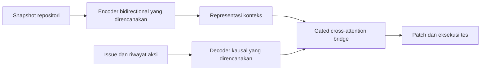

# BifocalGemma: Research Proposal

**Judul paper:** *BifocalGemma: Evaluating Bidirectional Repository Encoding for Local Code Repair*

**Target:** [Gemma 4 Developer Agent Paper Track](https://www.kaggle.com/competitions/gemma-4-developer-agent-paper).
Detail kompetisi yang belum terverifikasi dicatat dalam [panduan kompetisi](COMPETITION_GUIDE.md).

## Masalah dan pertanyaan riset

Perbaikan bug lintas file membutuhkan pencarian lokasi bug, pemahaman relasi kode,
dan generasi patch yang benar. Kami ingin menguji apakah encoder bidirectional
yang dipisahkan dari decoder generatif memberi manfaat pada agen lokal dengan
anggaran komputasi terbatas. Keuntungan terhadap decoder-only belum terbukti.

**Pertanyaan utama:** bagaimana kualitas perbaikan, latensi, dan peak VRAM berubah
saat representasi repositori bidirectional digunakan untuk mengondisikan decoder?

[T5Gemma](https://developers.googleblog.com/en/t5gemma/) merupakan prior art langsung
untuk adaptasi decoder-only menjadi encoder-decoder dan konfigurasi asimetris.
Adaptasi arsitektur tersebut sendiri bukan klaim kebaruan BifocalGemma. Kandidat
kontribusi adalah cara mengondisikan perbaikan kode dan analisis empiris lintas file.

## Pendekatan awal

Mulai dari kandidat **BifocalGemma-E2B-E2B**. Kelayakannya ditentukan melalui audit
bobot yang dimuat dan pengukuran memori, bukan penjumlahan parameter efektif.
Urutan kerja: pengukuran biaya backbone, integrasi attention dan bridge, adaptasi
terbatas pada data training (seperti subset terkurasi CommitPackFT dan task terisolasi SWE-smith),
lalu evaluasi pada tugas held-out perbaikan lintas file.
Ukuran data dan konfigurasi training baru ditetapkan setelah profiling.

Bridge menghitung `X + tanh(g) * CrossAttention(X, H)`, dengan `tanh(g)=0.05`
saat inisialisasi. Angka itu adalah skala residual tambahan; tidak menyatakan
persentase perilaku decoder yang dipertahankan atau persentase gradien.

Modul sekarang menyediakan bridge, embedding tipe/kedalaman AST, routing tensor,
ilustrasi self-KV, dan pelaporan skor. Pengujian menggunakan tensor sintetis;
ekstraksi AST, backbone, training, generasi, cache, serta benchmark belum terintegrasi.

## Bukti yang diperlukan

- Bandingkan dengan backbone decoder-only yang dijalankan menggunakan protokol,
  data adaptasi, konteks, dan token/tool budget sebanding. Sertakan prefix caching
  untuk prefix yang sama jika backend mendukungnya.
- Laporkan keberhasilan patch yang lolos tes, kualitas lokalisasi bug, latensi
  cold/warm cache, throughput, dan peak VRAM total. Laporkan pula parameter
  fisik/trainable, ukuran checkpoint, precision, dan hardware.
- Pisahkan ablation pengaruh representasi bidirectional dan fitur AST dari
  pengaruh data training atau budget. Laporkan kegagalan dan biaya tambahan.
- Gunakan tugas repositori held-out yang memiliki dependensi lintas file sebagai
  evaluasi utama (target utama: **SWE-bench Lite / Verified** untuk perbaikan bug end-to-end
  dan **CrossCodeEval** untuk dependensi lintas file); HumanEval-Fix/MBPP dapat menjadi pemeriksaan unit-level tambahan.

Hasil negatif tetap bernilai bila menjelaskan kapan biaya encoder/cross-attention
lebih besar daripada manfaatnya. Tidak ada target kemenangan atau skor yang dijamin.

## Eksperimen lanjutan

**BifocalGemma-E4B-E2B** dan **BifocalGemma-E2B-E4B** harus diuji bersama untuk
membahas alokasi kapasitas encoder versus decoder. **BifocalGemma-E4B-E4B**,
multimodal, contrastive localization loss, dan repository memory merupakan pekerjaan
lanjutan, bukan deliverable awal yang sudah tersedia.

Invalidasi satu hop tidak otomatis benar pada encoder full bidirectional: perubahan
satu file dapat memengaruhi representasi file lain secara global. Eksperimen awal
menggunakan re-encoding snapshot penuh setelah perubahan; pembaruan lokal memerlukan
desain attention terstruktur atau evaluasi aproksimasi terpisah.
