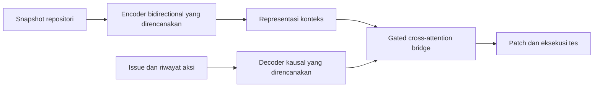

# BifocalGemma: Research Proposal

**Judul paper:** *BifocalGemma: Evaluating Bidirectional Repository Encoding for Local Code Repair*

**Target:** [Gemma 4 Developer Agent Paper Track](https://www.kaggle.com/competitions/gemma-4-developer-agent-paper).
Detail kompetisi yang belum terverifikasi dicatat dalam [panduan kompetisi](COMPETITION_GUIDE.md).

## Masalah dan pertanyaan riset

Perbaikan bug lintas file membutuhkan pencarian lokasi bug, pemahaman relasi kode,
dan generasi patch yang benar. Kami ingin menguji apakah encoder bidirectional
yang dipisahkan dari decoder generatif memberi manfaat pada agen lokal dengan
anggaran komputasi terbatas. Keuntungan terhadap decoder-only belum terbukti.

**Pertanyaan utama:** pada empat pasangan Gemma 4 Edge dengan encoder base dan
decoder IT, bagaimana kapasitas encoder versus decoder memengaruhi pemahaman
codebase, kualitas patch, latensi dan peak VRAM dibanding E2B-IT/E4B-IT decoder-only?

[T5Gemma](https://developers.googleblog.com/en/t5gemma/) merupakan prior art langsung
untuk adaptasi decoder-only menjadi encoder-decoder dan konfigurasi asimetris.
Adaptasi arsitektur tersebut sendiri bukan klaim kebaruan BifocalGemma. Kandidat
kontribusi adalah cara mengondisikan perbaikan kode dan analisis empiris lintas file.

## Pendekatan awal

Studi utama mencakup **E2B–E2B IT**, **E4B–E4B IT**, **E2B–E4B IT**, dan
**E4B–E2B IT**, ditambah baseline **E2B-IT** serta **E4B-IT**. Encoder berasal
dari checkpoint base, decoder dari checkpoint instruction-tuned. Pilot E2B–E2B
mendahului integrasi pasangan lain, tetapi keempatnya tetap target paper.

Tiga kontribusi yang ditargetkan adalah adaptasi encoder-decoder kelas Edge untuk
codebase understanding/repair, recipe initialization base encoder + IT decoder,
dan analisis faktorial kapasitas encoder/decoder. RQ utama, perbandingan khusus
E2B–E2B IT versus E4B-IT, serta kontrol untuk duel asimetris ada dalam
[desain eksperimen](EXPERIMENT_DESIGN.md). T5Gemma/T5Gemma 2 menjadi related work;
kedua keluarga itu tidak masuk perbandingan benchmark utama.

Ukuran data, precision dan budget adaptasi mengikuti profiling, dengan data dan
protokol sebanding untuk baseline. Pengujian arsitektur lokal tidak memuat bobot
model pretrained atau melatih model penuh.

Bridge menghitung `X + tanh(g) * CrossAttention(X, H)`, dengan `tanh(g)=0.05`
saat inisialisasi. Angka itu adalah skala residual tambahan; tidak menyatakan
persentase perilaku decoder yang dipertahankan atau persentase gradien.

Modul sekarang menyediakan bridge, embedding tipe/kedalaman AST, routing tensor,
ilustrasi self-KV, dan pelaporan skor. Pengujian menggunakan tensor sintetis;
ekstraksi AST, backbone, training, generasi, cache, serta benchmark belum terintegrasi.

## Bukti yang diperlukan

- Bandingkan dengan backbone decoder-only yang dijalankan menggunakan protokol,
  data adaptasi, konteks, dan token/tool budget sebanding. Sertakan prefix caching
  untuk prefix yang sama jika backend mendukungnya.
- Laporkan keberhasilan patch yang lolos tes, kualitas lokalisasi bug, latensi
  cold/warm cache, throughput, dan peak VRAM total. Laporkan pula parameter
  fisik/trainable, ukuran checkpoint, precision, dan hardware.
- Pisahkan ablation pengaruh representasi bidirectional dan fitur AST dari
  pengaruh data training atau budget. Laporkan kegagalan dan biaya tambahan.
- Gunakan tugas repositori held-out yang memiliki dependensi lintas file sebagai
  evaluasi utama (target utama: **SWE-bench Lite / Verified** untuk perbaikan bug end-to-end
  dan **CrossCodeEval** sebagai diagnostik completion lintas file, bukan resolved rate); HumanEval-Fix/MBPP dapat menjadi pemeriksaan unit-level tambahan.

Hasil negatif tetap bernilai bila menjelaskan kapan biaya encoder/cross-attention
lebih besar daripada manfaatnya. Tidak ada target kemenangan atau skor yang dijamin.

## Batas studi dan pekerjaan lanjutan

Empat pasangan simetris/asimetris merupakan bagian studi utama. Benchmark utama
dibatasi pada enam model yang sudah ditetapkan; kontrol kapasitas memakai matriks
lengkap dan duel E4B–E2B IT versus E2B–E4B IT. Mixed initialization adalah pilihan
metode yang belum terbukti unggul secara terisolasi tanpa kontrol initialization lain.
Kode saat ini masih gated cross-attention terpisah; merged attention dan tied
embeddings T5Gemma 2 bukan fitur yang sudah terimplementasi.

Multimodal, contrastive localization loss, merged attention dan partial repository
memory menjadi pekerjaan lanjutan.

Invalidasi satu hop tidak otomatis benar pada encoder full bidirectional: perubahan
satu file dapat memengaruhi representasi file lain secara global. Eksperimen awal
menggunakan re-encoding snapshot penuh setelah perubahan; pembaruan lokal memerlukan
desain attention terstruktur atau evaluasi aproksimasi terpisah.

Pemilihan sumber training, pemisahan data, dan kebutuhan harness diuraikan dalam
[riset dataset dan benchmark](DATASETS_AND_BENCHMARKS.md).
