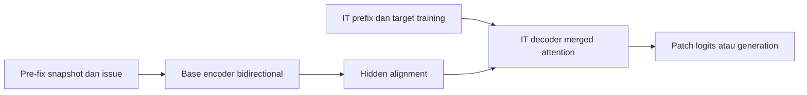

# BifocalGemma: Research Proposal

**Paper:** *BifocalGemma: Evaluating Bidirectional Repository Encoding for Local Code Repair*

**Target:** [Gemma 4 Developer Agent Paper Track](https://www.kaggle.com/competitions/gemma-4-developer-agent-paper).
Detail yang belum diverifikasi tetap dicatat pada [panduan kompetisi](COMPETITION_GUIDE.md).

## Masalah

Local code-repair membutuhkan pemahaman relasi lintas file, lokalisasi bug dan
patch yang benar. Kami menguji apakah pemisahan reader dan generator membantu
dalam keluarga Gemma 4 Edge, dengan biaya komputasi serta kualitas yang terukur.

## Metode yang ditargetkan

Encoder diinisialisasi dari Gemma 4 base dan memakai bidirectional text attention.
Decoder berasal dari Gemma 4 IT dan dibangun langsung dengan merged self/cross-attention.
Direct SFT mempelajari issue/context → patch. Simetris men-sharing ordinary words
dari decoder IT sejak awal; asimetris tetap separate, dengan adapter hidden states.
PLE tetap mengikuti backbone asal dan tidak di-sharing.

Encoder/decoder tetap dua jaringan; provenance tidak membutuhkan teacher yang
dilatih lebih dulu. Separated-to-merged conversion dan distillation menjadi opsi
research, sehingga recipe utama tidak menambah training tahap kedua.

## Tiga kontribusi yang ditargetkan

1. Adaptasi encoder-decoder berbasis Edge untuk memahami codebase dan repair lintas file.
2. Mixed initialization dengan explicit body/PLE base versus IT serta symmetric IT-word anchor.
3. Studi empat pasangan untuk mengukur pengaruh pilihan encoder/decoder dan trade-off kualitas/biaya.

Architecture adaptation sendiri punya prior art [T5Gemma](https://arxiv.org/abs/2504.06225)
dan [T5Gemma 2](https://arxiv.org/abs/2512.14856); encoder-decoder coding juga
bukan kategori baru. Novelty harus dibuktikan melalui recipe, analisis dan hasil.

## Desain dan bukti

Empat pasangan E2B–E2B IT, E4B–E4B IT, E2B–E4B IT, E4B–E2B IT menjadi studi
utama. Baseline hanya E2B-IT/E4B-IT decoder-only. Duel asimetris sama-sama untied
memberi perbandingan alokasi kapasitas utama. Full matrix juga dipengaruhi tying
policy, sehingga klaim faktor murni memerlukan controlled untied ablations.

E2B–E2B IT versus E4B-IT menjadi perbandingan khusus yang menarik, dengan physical
parameters, precision, training budget dan memory tetap dilaporkan. Kemenangan
tidak otomatis membuktikan iso-memory atau keunggulan arsitektur secara terisolasi.

Data training berasal dari sumber repair yang diaudit overlap. Held-out repair
success, localization, cold/warm latency, throughput dan peak VRAM merupakan bukti.
CrossCodeEval tambahan completion diagnostic, bukan patch-resolved metric.
[Desain eksperimen](EXPERIMENT_DESIGN.md) dan [dataset](DATASETS_AND_BENCHMARKS.md)
menentukan protokol; [evaluasi](EVALUATION.md) menjelaskan harness.

## Perkembangan dan status

Repo merupakan construction scaffold. Registry, collator, loss, word aliasing,
serializer dan reference attention sudah dapat diuji; native weight/layer/cache
integration, tokenization/data adapters, full trainer, generation dan harness
memiliki placeholder dengan kontrak.

[Build guide](BUILD_GUIDE.md) menyusun langkahnya seperti blok: selesaikan native
initialization/integration, data/profiling, SFT/checkpoint, lalu generation/harness.
Smoke test bukan hasil training atau benchmark. [Log riset](RESEARCH_LOG.md)
mencatat keputusan lama tanpa menjadikannya recipe default.
